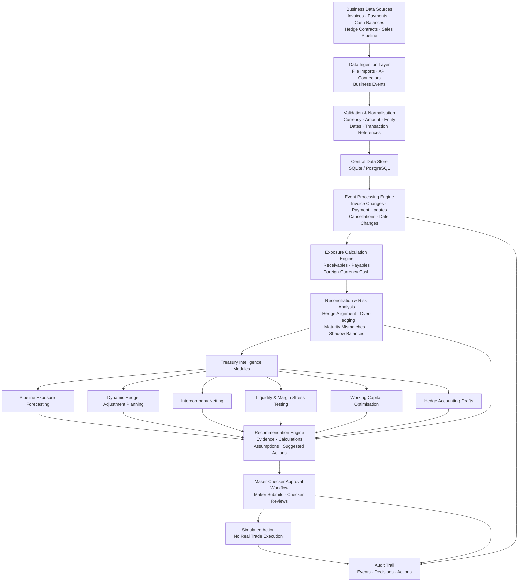

# FXNexus — Event-Driven FX Exposure & Treasury Workflow Platform

**Developed for the GIFT City FutureLab Challenge 2026–27**

FXNexus is an event-driven foreign exchange (FX) exposure management and treasury decision-support platform designed for exporters and mid-market businesses managing foreign-currency receivables, payables, cash balances and hedge contracts.

It demonstrates a **headless treasury overlay** that works alongside existing business systems. Rather than replacing an organisation's ERP, accounting or banking infrastructure, FXNexus aims to bring financial data together, track changes in underlying transactions, recalculate currency exposure, identify hedge mismatches and generate explainable recommendations.

The platform also explores advanced treasury capabilities, including pre-invoice pipeline exposure forecasting, dynamic hedge adjustment planning, shadow-balance reconciliation, intercompany netting, liquidity and margin stress testing, working-capital optimisation and draft hedge-accounting documentation.

> **Prototype boundary:** FXNexus is a decision-support prototype. It does not execute real derivatives, send trade instructions to banks, handle funds, make legal or accounting determinations, or provide investment advice. Its execution workflow is simulation-only. Recommendations require appropriate human and professional review.

---

## 1. The Problem

Businesses involved in international trade are exposed to fluctuations in foreign exchange rates. Changes in exchange rates, payment dates, shipment schedules, invoice values and customer commitments can affect their expected cash flows.

However, relevant financial information is often distributed across accounting software, spreadsheets, CRM platforms, banking records and hedge contracts.

This fragmentation makes it difficult to maintain an accurate view of actual FX exposure and can result in:

- Mismatched or excessive hedge positions.
- Exposure changes going unnoticed after invoice or payment updates.
- Foreign-currency balances being incorrectly treated as settled exposure.
- Unexpected liquidity and margin pressure.
- Limited visibility into potential exposure before an invoice is created.

FXNexus aims to address these challenges through a unified, event-driven and explainable treasury workflow.

## 2. How FXNexus Works

FXNexus follows an event-driven processing approach. Financial records and business events enter the platform, are normalised and stored, and are then processed by the exposure and reconciliation engines. The resulting analysis feeds treasury modules that generate recommendations for human review.

### System workflow



### Processing flow explained

1. **Data ingestion:** Financial information enters through sample datasets, supported business events and available API connectors.
2. **Validation and normalisation:** Records are checked and organised using fields such as currency, amount, transaction date, legal entity and transaction reference.
3. **Event processing:** Changes such as partial payments, invoice amendments, cancellations and payment-date updates trigger reassessment.
4. **Exposure calculation:** The platform evaluates foreign-currency receivables, payables and relevant cash balances.
5. **Reconciliation:** Existing hedge records are compared against underlying exposures to identify mismatches, excessive hedge amounts and maturity differences.
6. **Treasury analysis:** Additional modules evaluate pipeline exposure, hedge adjustments, netting opportunities, liquidity pressure and working-capital alternatives.
7. **Recommendations:** The system generates suggested actions supported by calculations, source evidence and assumptions.
8. **Approval and simulation:** A Maker submits a proposal and a Checker reviews it before an internal simulated action.
9. **Audit trail:** Relevant events, decisions and actions are recorded for traceability.

The current prototype uses deterministic rules and sample data for its demonstrations. The diagram represents the overall platform workflow, including capabilities at different stages of implementation.

---

## 3. Core Features

| Module | Functionality |
|---|---|
| Overview Dashboard | Displays current exposure, receivables, payables, hedge coverage and alerts. |
| Transactions | Manages invoice and payment records and supports transaction-event updates. |
| Hedge Alignment | Identifies mismatches between hedge contracts and underlying exposures. |
| Recommendations | Generates evidence-backed treasury recommendations. |
| Maker-Checker Approvals | Routes proposed actions through a two-role approval workflow. |
| Pipeline Forecasting | Estimates potential pre-invoice exposure using sales-deal probabilities. |
| Dynamic Hedge Adjustment | Identifies maturity mismatches and prepares adjustment or roll proposals. |
| Shadow Balance Reconciliation | Distinguishes foreign-currency receipts retained as cash from those converted into another currency. |
| Intercompany Netting | Evaluates compatible reciprocal positions across group entities. |
| Liquidity Stress Testing | Models cash-flow pressure under FX shocks and assumed margin calls. |
| Working Capital Optimisation | Compares illustrative hedge economics with early-payment discounts and financing costs. |
| Scenario Lab | Simulates FX movements, payment delays and invoice changes. |
| Accounting Drafts | Generates draft hedge-accounting documentation for professional review. |
| Audit Trail | Records supported events, decisions and simulated actions. |
| Connections | Provides the available external integration configuration and testing interface. |

---

## 4. Technology Stack

| Layer | Technology |
|---|---|
| Frontend | React, TypeScript, Vite |
| UI and Icons | Lucide icons, CSS |
| Backend | Python, FastAPI, Pydantic |
| Database | SQLite by default; PostgreSQL supported through `DATABASE_URL` |
| ORM | SQLAlchemy |
| Financial Calculations | Python `Decimal` and SQL `NUMERIC` |
| API Documentation | FastAPI / Swagger UI |
| External Data | Zoho Books read-only retrieval scaffold; Twelve Data reference-rate adapter |
| Testing | Pytest |

### Architecture principles

- **Modular design:** Separate components for ingestion, calculations, reconciliation, recommendations and approvals.
- **Event-driven processing:** Changes in underlying business transactions can trigger exposure reassessment.
- **Explainability:** Recommendations include supporting evidence, assumptions and calculation details.
- **Human oversight:** Proposed actions pass through a Maker-Checker workflow.
- **Integration-first approach:** Designed to complement existing ERP, accounting, CRM and banking systems.
- **Financial precision:** Backend calculations use decimal arithmetic instead of binary floating-point arithmetic.

---

## 5. Quick Start — Windows PowerShell

### Requirements

- Python 3.11+
- Node.js 22.12+
- npm

### 1. Start the backend

Open a terminal in the project directory:

```powershell
cd backend

py -m venv .venv

.\.venv\Scripts\python.exe -m pip install -r requirements.txt

Copy-Item .env.example .env

.\.venv\Scripts\python.exe -m uvicorn app.main:app --reload --port 8000
```

The backend will run at:

`http://localhost:8000`

### 2. Start the frontend

Open a second terminal in the project directory:

```powershell
cd frontend

npm.cmd install

Copy-Item .env.example .env

npm.cmd run dev
```

The frontend will run at:

`http://localhost:5173`

### 3. Open FXNexus

- Application: http://localhost:5173
- Backend API: http://localhost:8000
- API documentation: http://localhost:8000/docs

The frontend opens at the FXNexus sign-in page.

### Local demo accounts

| Role | Email | Password |
|---|---|---|
| Maker | `maker@fxnexus.local` | `Maker-Demo-2026!` |
| Checker | `checker@fxnexus.local` | `Checker-Demo-2026!` |

These accounts are intended only for the local demonstration. Change the credentials in `backend/.env` before sharing the project.

The backend creates a local SQLite database and seeds a demo company on first start. No third-party API keys are required to run the seeded demonstration.

---

## 6. Suggested Demo Workflow

1. Sign in as Maker and open **Overview** to inspect the current exposure position and alerts.
2. Open **Transactions** and use the event simulator to record a partial payment. Select whether the payment was converted into INR or retained in USD.
3. Open **Recommendations** and inspect the resulting exposure and hedge mismatch analysis.
4. Create an action proposal as Maker and submit it for approval.
5. Sign out and sign in as Checker.
6. Review the proposal, verify the required controls and approve it internally.
7. Run the separate action simulation. This does not modify a real hedge contract or send an order to a bank.
8. Explore the other modules: **Pipeline**, **Hedge Alignment**, **Shadow Balances**, **Netting**, **Liquidity**, **Working Capital**, **Scenario Lab**, **Accounting Drafts** and **Audit Trail**.
9. Open **Connections** to test the available Zoho read-only fetch and Twelve Data reference-rate adapter after configuring the required credentials.

---

## 7. Environment Variables and Integrations

See:

- `backend/.env.example`
- `frontend/.env.example`

### Required credentials

None. The sample-data demonstration works without external API credentials.

### Optional integrations

| Variable | Where to obtain it | Purpose |
|---|---|---|
| `ZOHO_CLIENT_ID` | Zoho API Console → Server-based application | OAuth client ID |
| `ZOHO_CLIENT_SECRET` | Same Zoho application | OAuth client secret |
| `ZOHO_REFRESH_TOKEN` | Zoho OAuth consent flow | Server-side token refresh |
| `ZOHO_ORGANIZATION_ID` | Zoho Books organisation settings or API response | Selects the Books organisation |
| `ZOHO_ACCOUNTS_URL` | `https://accounts.zoho.in` for India DC | OAuth token endpoint |
| `ZOHO_API_BASE_URL` | `https://www.zohoapis.in/books/v3` for India DC | Zoho Books API base |
| `TWELVE_DATA_API_KEY` | Twelve Data dashboard | Indicative FX reference rates |
| `OPENAI_API_KEY` | OpenAI API platform | Reserved optional narrative-explanation integration |
| `OPENAI_MODEL` | Model available to the API project | Optional explanation model configuration |
| `DATABASE_URL` | PostgreSQL provider connection settings | Optional hosted PostgreSQL database |

### Zoho Books scopes

The current read-only prototype uses:

```text
ZohoBooks.invoices.READ,ZohoBooks.customerpayments.READ
```

The backend expects an OAuth refresh token. A Zoho Self Client can be used to generate a grant code and exchange it for a refresh token.

The `ZOHO_REDIRECT_URI` setting is reserved for a future full server-based OAuth callback flow. A callback route is not currently implemented.

**Security:** Never put Zoho client secrets, refresh tokens, OpenAI keys, Twelve Data keys or database secret credentials in frontend environment variables. Do not commit `.env` files to GitHub.

### Supabase / PostgreSQL note

The MVP uses SQLAlchemy directly. To use Supabase PostgreSQL, configure `DATABASE_URL` with a PostgreSQL connection string.

For example:

```text
postgresql+psycopg://postgres.<project-ref>:<password>@<pooler-host>:6543/postgres
```

Prefer the appropriate connection pooler for hosted deployments. The current architecture does not require Supabase browser keys.

---

## 8. Implementation Status and Limitations

The following table distinguishes working prototype functionality from integrations and capabilities that remain planned or incomplete.

| Capability | Current Status |
|---|---|
| Invoice, payment and hedge demo data | Working |
| Event ingestion and idempotency | Working; includes invoice-date and mapped CRM-deal update event types |
| Exposure recalculation | Working MVP rules |
| Hedge mismatch detection | Working MVP rules |
| Recommendations and action proposals | Working |
| Maker-Checker approvals | Working local demonstration with separate Maker and Checker accounts |
| Stale snapshot protection | Working |
| Simulated hedge adjustment / roll proposal | Working proposal and local simulation; no external execution |
| Pipeline probability scenarios | Working illustrative model with probability-weighted exposure and soft-planning bands |
| Scenario Lab | Working illustrative USD/INR scenario functionality |
| Shadow-balance reconciliation | Working demo ledger with retained, converted and unresolved payment treatments |
| Intercompany netting | Working illustrative calculation with reciprocal positions and a seven-day demo timing window |
| Liquidity and margin stress testing | Working simplified calculator using assumed margin-call inputs and cash snapshots |
| Working-capital vs hedge-cost comparison | Working illustrative calculator |
| Hedge-accounting documentation | Draft template only; not a compliance opinion or journal-entry generator |
| Zoho Books integration | OAuth refresh and read-only invoice/payment retrieval scaffold; fetched objects are not yet mapped into local tables |
| Twelve Data integration | Reference-rate adapter scaffold; rates are not executable quotes |
| CRM / ERP integrations | Integration architecture and connector targets; live provider integrations are not connected apart from the Zoho read-only retrieval scaffold |
| Bank APIs / Account Aggregator | Not integrated |
| OANDA / Interactive Brokers | Not integrated; no broker execution |
| Real derivative execution | Not implemented |

### Important interpretation notes

- Pipeline exposure is a forecast, not a confirmed receivable.
- A foreign-currency receipt retained in that currency can continue to carry FX exposure.
- Economic netting calculations do not establish legal eligibility for settlement.
- Liquidity stress tests use simplified assumptions and do not represent live bank margin calls.
- Accounting drafts require review by qualified accounting professionals.
- FX reference rates are indicative and must not be treated as executable market quotes.

---

## 9. Running Tests

From the project directory:

```bash
cd backend
pytest
```

---

## 10. Authentication and Security Notes

The local sign-in page uses two demo accounts with environment-configured credentials.

The backend issues expiring in-memory bearer sessions and enforces:

- Maker-only proposal submission.
- Checker-only approval and simulation.
- Separate review and approval responsibilities.

This is suitable for a local prototype walkthrough, not production identity management.

Before real company deployment, additional security work would be required, including:

- A proper identity provider and multi-factor authentication.
- Tenant-level database access controls.
- Secure storage of OAuth tokens and credentials.
- Signed webhook verification.
- Persistent session management and revocation.
- More comprehensive audit retention and tamper-resistance.
- Security assessment and penetration testing.

---

## 11. Future Development Roadmap

FXNexus is designed to evolve from a local prototype into an integration-driven treasury intelligence platform.

Potential future development areas include:

1. **ERP and accounting integrations:** Expand beyond the current Zoho retrieval scaffold to systems such as Tally, NetSuite and SAP.
2. **CRM integrations:** Connect platforms such as HubSpot and Salesforce to support earlier exposure forecasting.
3. **Banking data connectivity:** Explore secure, consent-based access to relevant bank and cash-flow information.
4. **Advanced forecasting:** Develop payment-delay and cash-flow forecasting using suitable historical data.
5. **Optimisation engine:** Introduce more advanced hedge and liquidity optimisation where validated business requirements justify it.
6. **Production security:** Implement enterprise-grade identity, tenant isolation, credential management and audit infrastructure.
7. **Industry pilot testing:** Validate calculations and recommendations with exporters and treasury professionals.
8. **Regulatory and accounting review:** Obtain specialist review before expanding into regulated execution workflows or production accounting functionality.

Any future derivative execution capability would need to operate through appropriately authorised financial institutions and comply with applicable regulatory requirements.

---

## 12. Project Team

FXNexus was developed as a team project for the **GIFT City FutureLab Challenge 2026–27**.

| Team Member | Role and Contribution |
|---|---|
| **Jiya Shah** — Team Leader | Backend development, core logic and system integration |
| **Tanisha** | Frontend development, UI and research analysis |
| **Namrata** | Frontend development, financial analysis and documentation |

---

**FXNexus — Connecting financial events to explainable treasury decisions.**
